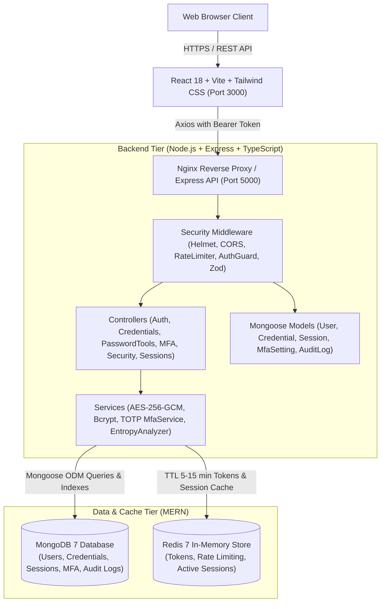

# SecureVault — Secure Password Manager & Recovery Platform (MERN Stack)

[](https://www.typescriptlang.org/)
[](https://reactjs.org/)
[](https://expressjs.com/)
[](https://www.mongodb.com/)
[](https://redis.io/)
[](https://www.docker.com/)
[](LICENSE)

> **Academic Full Stack Development (FSD) Third-Year Capstone Project — MERN Stack**  
> A realistic, modular, and security-focused enterprise web application for authenticated credential vaulting, live Shannon entropy analysis, multi-factor authentication (TOTP), password reuse detection, and active session revocation.

---

## 1. Executive Summary & Problem Statement

### The Problem
Credential stuffing, weak passwords, and database leakages represent over 80% of web application breaches. Traditional password managers often run into pitfalls:
1. **Plaintext or Weak Encryption in Storage**: Many demo applications store credentials in plaintext or with reversible weak ciphers.
2. **Lack of Password Reuse Detection**: Users reuse the same password across multiple sites, creating a single point of failure.
3. **Missing Multi-Factor Authentication**: Single-factor authentication fails to prevent unauthorized takeovers when master credentials leak.
4. **Unmanaged Ghost Sessions**: Dormant device logins remain active indefinitely without user visibility or remote revocation capabilities.

### The SecureVault Solution
**SecureVault** delivers an end-to-end zero-knowledge security architecture built on the modern **MERN Stack**:
- **AES-256-GCM Authenticated Encryption**: Credentials are encrypted before saving, with a distinct 96-bit initialization vector (IV) and 128-bit authentication tag per item. Tampering causes immediate decryption rejection.
- **Salted Bcrypt Password Hashing**: Master passwords are never stored in plaintext.
- **RFC 6238 TOTP Two-Factor Authentication**: Real-time integration with Google Authenticator, Authy, and 1Password, backed by hashed one-time recovery codes.
- **Password Reuse Detection Engine**: Isolates duplicate passwords across the user's personal vault and alerts them before an attacker can exploit credential stuffing.
- **Real-Time Password Strength & Entropy Meter**: Computes Shannon entropy in bits, detects keyboard walking (`qwerty`, `12345`), checks character diversity, and identifies repeated sequences.
- **"Burn-After-Reading" Ephemeral Secret Sharing**: Generates single-use, self-destructing links backed by Redis TTL (5 mins to 7 days). The instant the secret is revealed, it is permanently wiped and burned from server memory, solving the problem of leaking secrets over WhatsApp/email.
- **Credential Aging & 90-Day Rotation Policy**: Tracks timestamp-based password lifecycle (Fresh <30d, Aging 30-90d, Stale >90d) to prevent dormant credential exposure in accordance with NIST guidelines.
- **Stateful Session Governance & Instant Remote Revocation**: Device tracking in MongoDB and cached in Redis with instant token revoking.
- **Simulated Recovery Workflow**: 15-minute expiring cryptographically random reset tokens in Redis with automatic invalidation of all existing sessions upon password reset.

### Key Security Architecture Innovations
| Security Feature | Traditional Password Managers | SecureVault Architecture |
|---|---|---|
| **One-Time Secret Sharing** | ❌ None (Users leak passwords in plaintext chats) | ✅ **Burn-After-Reading 1-View Links** with automatic server wipe |
| **Password Aging & Stale Alerts** | ❌ Dormant passwords sit for years without warning | ✅ **Active 90-Day Aging Tracker** with rotation enforcement |
| **Mathematical Entropy Analysis** | ❌ Basic regex rule checking (fails against patterns) | ✅ **Shannon Entropy in bits** + keyboard walk detection |
| **Session Governance** | ❌ Only full account sign-out | ✅ **Granular per-device session management** with remote kill |
| **Data Sovereignty** | ❌ Proprietary cloud lock-in | ✅ **Self-hosted zero-knowledge** containerized MERN stack |

---

## 2. Application Architecture



---

## 3. Technology Stack & Technical Justification

| Layer | Technology | Key Justification |
|---|---|---|
| **Frontend** | React 18, TypeScript, Vite | Fast HMR, type safety, modular component hierarchy |
| **Styling** | Tailwind CSS, Lucide Icons | Clean cybersecurity SaaS aesthetic, dark mode, responsive mobile/desktop |
| **Backend** | Node.js, Express.js, TypeScript | Non-blocking async I/O, strict typing, clean controller/service separation |
| **Database** | MongoDB 7 & Mongoose ODM | Flexible document store, BSON indexing, schema validation, high write throughput |
| **Cache & Tokens** | Redis 7 (`ioredis`) | Fast sub-millisecond retrieval, native key expiration (TTL) for OTP/reset tokens |
| **Vault Encryption**| Node `crypto` AES-256-GCM | Authenticated encryption: confidentiality + integrity verification via 16-byte Auth Tag |
| **Auth Hashing** | Bcrypt (`bcryptjs`) | Salted, adaptive CPU-hard hashing resilient against GPU brute force |
| **MFA (2FA)** | `otplib` + `qrcode` | Industry standard RFC 6238 TOTP with QR scanning and emergency backup codes |
| **Validation** | Zod | Runtime request body, query, and parameter schema enforcement |
| **Security Headers**| Helmet, CORS | CSP, XSS protection, anti-clickjacking, origin whitelisting |
| **DevOps** | Docker & Docker Compose | Containerized multi-service orchestration with health checks |

---

## 4. Database Schema Design (Mongoose Models)

The MongoDB database enforces data models using Mongoose schemas with indexed fields and automated virtual transformations:

```typescript
// 1. User Schema (Collection: users)
{
  name: { type: String, required: true },
  email: { type: String, required: true, unique: true, index: true },
  passwordHash: { type: String, required: true },
  mfaEnabled: { type: Boolean, default: false },
  createdAt: Date,
  updatedAt: Date
}

// 2. Credential Schema (Collection: credentials)
{
  userId: { type: String, required: true, index: true },
  website: { type: String, required: true, index: true },
  username: { type: String, required: true },
  encryptedPassword: { type: String, required: true }, // AES-256-GCM ciphertext
  iv: { type: String, required: true },                // 12-byte random IV (hex)
  authTag: { type: String, required: true },           // 16-byte authentication tag (hex)
  createdAt: Date,
  updatedAt: Date
}

// 3. Session Schema (Collection: sessions)
{
  userId: { type: String, required: true, index: true },
  sessionIdentifier: { type: String, required: true, unique: true },
  userAgent: { type: String, default: '' },
  ipAddress: { type: String, default: '' },
  expiresAt: { type: Date, required: true, index: true },
  revokedAt: { type: Date, default: null },
  createdAt: Date
}

// 4. MfaSetting Schema (Collection: mfasettings)
{
  userId: { type: String, required: true, unique: true, index: true },
  secret: { type: String, required: true },            // Base32 TOTP secret
  backupCodes: { type: [String], default: [] },        // Bcrypt-hashed backup recovery codes
  createdAt: Date,
  updatedAt: Date
}

// 5. AuditLog Schema (Collection: auditlogs)
{
  userId: { type: String, default: null, index: true },
  action: { type: String, required: true, index: true },
  ipAddress: { type: String, default: '' },
  userAgent: { type: String, default: '' },
  metadata: { type: Schema.Types.Mixed, default: {} }, // Redacted security metadata
  createdAt: Date
}
```

---

## 5. REST API Documentation

All responses conform to standardized JSON schemas:
```json
{
  "success": true,
  "message": "Operation successful",
  "data": { ... }
}
```

### Authentication (`/api/auth`)
| Method | Endpoint | Description | Auth Required |
|---|---|---|---|
| `POST` | `/api/auth/register` | Register new user with master password | No |
| `POST` | `/api/auth/login` | Login (returns JWT or `mfaRequired: true`) | No |
| `POST` | `/api/auth/mfa-login` | Submit 6-digit TOTP or backup code | No |
| `POST` | `/api/auth/logout` | Revoke session and clear cookies | Yes |
| `GET` | `/api/auth/me` | Fetch authenticated user profile | Yes |
| `POST` | `/api/auth/forgot-password` | Generate 15-min recovery token (Redis) | No |
| `POST` | `/api/auth/verify-reset` | Validate token status | No |
| `POST` | `/api/auth/reset-password` | Set new password & revoke all old sessions | No |

### Credential Vault (`/api/credentials`)
| Method | Endpoint | Description | Auth Required |
|---|---|---|---|
| `GET` | `/api/credentials` | List saved credentials (masked passwords) | Yes |
| `POST` | `/api/credentials` | Encrypt (AES-256-GCM) and store credential | Yes |
| `GET` | `/api/credentials/:id` | Decrypt & reveal password for owner (403 if unauth) | Yes |
| `PUT` | `/api/credentials/:id` | Update website, username, or re-encrypt password | Yes |
| `DELETE` | `/api/credentials/:id` | Permanently delete credential from vault | Yes |

### Password Utilities (`/api/password`)
| Method | Endpoint | Description | Auth Required |
|---|---|---|---|
| `POST` | `/api/password/analyze` | Calculate Shannon entropy, checklist, and warnings | No |
| `POST` | `/api/password/generate` | CSPRNG password generation (12-64 length) | No |

### Multi-Factor Authentication (`/api/mfa`)
| Method | Endpoint | Description | Auth Required |
|---|---|---|---|
| `GET` | `/api/mfa/status` | Get MFA state and remaining backup codes count | Yes |
| `POST` | `/api/mfa/setup` | Generate TOTP secret, QR code, backup codes | Yes |
| `POST` | `/api/mfa/verify` | Verify 6-digit code and activate MFA | Yes |
| `POST` | `/api/mfa/disable` | Confirm master password and disable MFA | Yes |

### Security Dashboard & Audit Activity
| Method | Endpoint | Description | Auth Required |
|---|---|---|---|
| `GET` | `/api/security/score` | Compute overall 0-100 score, reuse & hygiene | Yes |
| `GET` | `/api/security/recommendations` | Get actionable security recommendations | Yes |
| `GET` | `/api/activity` | Paginated chronological audit logs | Yes |
| `GET` | `/api/sessions` | List active sessions | Yes |
| `DELETE` | `/api/sessions/:id` | Revoke a specific active session | Yes |
| `POST` | `/api/sessions/revoke-others` | Revoke all other sessions except current | Yes |

---

## 6. Security & Cryptographic Design

### 1. AES-256-GCM Authenticated Encryption
- Cipher: Galois/Counter Mode with 256-bit symmetric key.
- Initialization Vector (IV): Cryptographically random 12 bytes (`crypto.randomBytes(12)`), never reused.
- Authentication Tag: 16 bytes (`cipher.getAuthTag()`).
- Tamper Resistance: Any tampering with ciphertext or auth tag throws an error in `crypto.createDecipheriv`, preventing padding oracle or bit-flipping attacks.

### 2. Salted Bcrypt Password Hashing
- User master passwords are processed with a work factor of 10 rounds (`bcryptjs.hash(password, 10)`).
- Plaintext authentication passwords are never stored in databases, logs, or response bodies.

### 3. Isolated Multi-Tenant Authorization
- Every credential query strictly filters by `WHERE user_id = $1`.
- Direct object reference attacks (e.g. User A requesting User B's credential UUID) are caught by ownership checks and immediately return `403 Forbidden` with an audit log event (`UNAUTHORIZED_CREDENTIAL_ACCESS_ATTEMPT`).

### 4. Ephemeral Redis Storage (TTL)
- Password reset tokens: 15-minute TTL (`SET key value EX 900`).
- Temporary MFA login challenge tokens: 5-minute TTL (`SET key value EX 300`).
- Tokens are immediately deleted upon one-time consumption.

---

## 7. Installation & Local Development

### Prerequisites
- **Node.js**: v18.0.0 or higher
- **PostgreSQL**: v14+ (or run via Docker)
- **Redis**: v6+ (or automatic in-memory fallback)
- **Docker & Docker Compose** (recommended)

### Option A: Running with Docker Compose (Recommended)
The entire multi-service stack (Frontend + Backend + PostgreSQL + Redis) boots with one command:

```bash
# 1. Clone or navigate to the repository
cd securevault

# 2. Start all containers with auto-build
docker compose up --build
```
- Frontend UI: `http://localhost:3000`
- Backend API: `http://localhost:5000`
- API Health Check: `http://localhost:5000/api/health`

---

### Option B: Running Manually on Local Host

#### 1. Setup Backend
```bash
cd backend
npm install

# Build TypeScript
npm run build

# Run automated security test suite
npm test

# Seed database with sample demo data (ensure MongoDB is running)
npm run seed

# Start backend in development mode
npm run dev
```

#### 2. Setup Frontend
```bash
cd ../frontend
npm install

# Start Vite dev server
npm run dev
```
Frontend runs at `http://localhost:3000` and automatically proxies `/api` requests to backend on port `5000`.

---

## 8. Demo Credentials & Academic Presentation Flow

### Default Demo Account
- **Email**: `demo@example.com`
- **Master Password**: `DemoPassword123!`
- *(Or register any new account on the registration page)*

### Step-by-Step Live Defense Demonstration
1. **Landing Page**: Open `http://localhost:3000` to view the cybersecurity SaaS hero, feature cards, and security architecture explanation.
2. **Registration & Strength Meter**: Click **Get Started**, type different passwords, and watch the live Shannon entropy meter, character checklist, and dictionary pattern alerts.
3. **Login & Session Issuance**: Sign in as `demo@example.com` (use the quick **⚡ Autofill Demo Account** button).
4. **Security Dashboard**: View the dynamic **Overall Security Score (e.g. 87 / 100)** with individual progress bars for Password Strength, Password Reuse, 2FA, and Credential Hygiene.
5. **Password Generator**: Navigate to **Password Generator**, adjust length slider (12-64), toggle character sets, and generate a high-entropy password with one-click copy.
6. **Password Analyzer**: Navigate to **Password Analyzer**, test a common password like `qwerty12345` to show pattern detection, then test a high-entropy password.
7. **Credential Vault (AES-256-GCM)**:
   - Open **Vault** to see saved accounts with masked passwords.
   - Click **Add Credential**, use the embedded generator, and save.
   - Click **Reveal** to decrypt the password on-demand via AES-256-GCM.
8. **Password Reuse Detection**:
   - Add another credential using the exact same password.
   - Return to **Dashboard** and **Security** page to see the **⚠ Password Reused Across 2 Accounts** warning badge and recommendations.
9. **Multi-Factor Authentication (TOTP)**:
   - Go to **Settings**, click **Enable MFA**.
   - Scan the QR code with Google Authenticator or copy the secret key.
   - Copy the emergency backup recovery codes.
   - Enter the 6-digit TOTP code to activate.
   - Log out, sign in again with email and password, and observe the Two-Factor challenge screen requiring the 6-digit code.
10. **Active Session Revocation**:
    - Open **Security** page to see active sessions. Click **Revoke** on any remote session.
11. **Account Recovery (Development Mode)**:
    - Log out and click **Forgot Password?**.
    - Enter your email. In development mode, the expiring 15-minute token is displayed directly with a one-click button.
    - Set a new master password. Verify that all previous sessions are invalidated.
12. **Audit Activity Trail**:
    - Open **Activity** page to inspect the chronological timeline of logins, credential creations, reveals, and security events.

---

## 9. Git & GitHub Commands

To initialize and push this project to a new GitHub repository:

```bash
# Navigate to the project root
cd securevault

# Initialize git
git init
git add .
git commit -m "feat: complete SecureVault password manager & recovery platform"

# Create a new branch
git branch -M main

# Link to your remote GitHub repository
git remote add origin https://github.com/YOUR_GITHUB_USERNAME/securevault.git

# Push to GitHub
git push -u origin main
```

---

## 10. Verification & Test Suite

The project includes an automated test suite verifying cryptographic correctness and multi-tenant security isolation:

```bash
cd backend
npm test
```

### Verified Test Cases:
- `✓ AES-256-GCM Authenticated Encryption`: Encrypts and decrypts round-trip correctly.
- `✓ Tamper Detection`: Fails decryption if ciphertext or authentication tag is modified.
- `✓ Unique IV Generation`: Guaranteed distinct 96-bit initialization vectors per call.
- `✓ Password Analyzer`: Accurately flags common dictionary words, repeated chars, and keyboard sequences.
- `✓ Entropy Calculation`: Computes theoretical Shannon entropy in bits.
- `✓ Password Generator`: Enforces character diversity and length constraints.
- `✓ Password Hashing`: Hashes passwords with salted bcrypt; constant-time comparison.
- `✓ TOTP Setup & Verification`: Generates RFC 6238 keyuri, QR code, and backup codes.
- `✓ Multi-Tenant Security Isolation`: Enforces strict tenant barriers (User A cannot access User B's vault items).

---

## 11. Project Structure

```
securevault/
├── frontend/
│   ├── src/
│   │   ├── components/       # Card, Badge, Button, Input, Modal, StrengthMeter, Add/Edit Credential
│   │   ├── pages/            # Landing, Login, Register, MfaVerify, Forgot, Reset, Dashboard, Vault, Generator, Analyzer, Security, Activity, Settings
│   │   ├── layouts/          # DashboardLayout (Sidebar, Navbar)
│   │   ├── context/          # AuthContext, ToastContext
│   │   ├── services/         # Axios client and REST endpoint services
│   │   ├── types/            # TypeScript interfaces
│   │   ├── App.tsx           # Router configuration
│   │   ├── main.tsx          # Vite React entry point
│   │   └── index.css         # Tailwind directives & animations
│   ├── index.html
│   ├── vite.config.ts        # Vite configuration with /api proxy
│   ├── tailwind.config.js    # Custom cyber SaaS theme palette
│   ├── nginx.conf            # Production Nginx reverse proxy
│   ├── Dockerfile
│   └── package.json
│
├── backend/
│   ├── src/
│   │   ├── config/           # Database (pg pool), Redis client, Environment variables
│   │   ├── controllers/      # Auth, Credentials, PasswordTools, MFA, Security, Activity, Sessions
│   │   ├── routes/           # Express router endpoints
│   │   ├── services/         # AES-256-GCM, Bcrypt Hashing, TOTP MFA, PasswordAnalyzer, SessionService, AuditLogger
│   │   ├── middleware/       # AuthGuard, RateLimiter, Zod Validator, Centralized Error Handler
│   │   ├── validators/       # Zod schemas (Registration, Login, MFA, Reset, Credentials)
│   │   └── server.ts         # Express bootstrap, Helmet, CORS, and HTTP server
│   ├── tests/                # Automated Vitest security & cryptographic tests
│   ├── Dockerfile
│   ├── tsconfig.json
│   └── package.json
│
├── database/
│   ├── migrations/
│   │   └── 001_init_schema.sql  # Relational PostgreSQL schema
│   └── seed.sql                 # Sample demo account and initial audit records
│
├── docker-compose.yml        # Orchestration: Frontend + Backend + PostgreSQL + Redis
├── .env.example              # Template environment variables
├── .gitignore                # Production gitignore
└── README.md                 # Complete documentation
```

---

## 12. Academic Evaluation Checklist

| Requirement | Implementation Status | Location |
|---|---|---|
| User Registration & Login | Completed | `frontend/src/pages/RegisterPage.tsx`, `backend/src/controllers/auth.controller.ts` |
| Password Hashing | Completed (Bcrypt 10 rounds) | `backend/src/services/hashing.service.ts` |
| Credential Vault Encryption | Completed (AES-256-GCM + IV + Tag) | `backend/src/services/encryption.service.ts` |
| Multi-Factor Authentication | Completed (RFC 6238 TOTP + QR) | `backend/src/services/mfa.service.ts`, `frontend/src/pages/SettingsPage.tsx` |
| Password Strength Analyzer | Completed (Entropy + Pattern Checks) | `backend/src/services/passwordAnalyzer.service.ts`, `frontend/src/pages/PasswordAnalyzerPage.tsx` |
| Strong Password Generator | Completed (CSPRNG, 12-64 chars) | `backend/src/services/passwordGenerator.service.ts`, `frontend/src/pages/PasswordGeneratorPage.tsx` |
| Password Reuse Detection | Completed | `backend/src/services/securityScore.service.ts`, `frontend/src/pages/SecurityPage.tsx` |
| Security Score & Metrics | Completed (Weighted 0-100 Score) | `frontend/src/pages/DashboardPage.tsx`, `backend/src/services/securityScore.service.ts` |
| Session Revocation | Completed (Single & Bulk Revocation) | `backend/src/services/session.service.ts`, `frontend/src/pages/SecurityPage.tsx` |
| Secure Password Recovery | Completed (15-min Redis TTL) | `frontend/src/pages/ForgotPasswordPage.tsx`, `frontend/src/pages/ResetPasswordPage.tsx` |
| Audit Activity Logging | Completed (Redacted Metadata) | `backend/src/services/auditLogger.service.ts`, `frontend/src/pages/ActivityPage.tsx` |
| Docker & Docker Compose | Completed (4 Services + Healthchecks) | `docker-compose.yml`, `backend/Dockerfile`, `frontend/Dockerfile` |
| Multi-Tenant Authorization | Completed (Strict User Isolation) | `backend/src/controllers/credentials.controller.ts`, `backend/tests/security.test.ts` |
